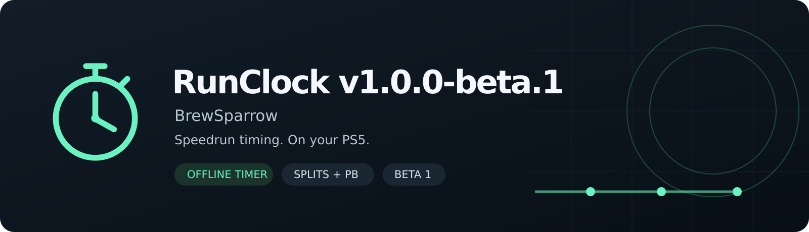

# RunClock v1.0.1-beta.2

**By BrewSparrow**

Time your runs, record splits, and save attempts directly on your PS5. RunClock is a standalone **RunClock.elf** payload loaded through **Payload Manager**. It runs entirely on the console and requires no external server, account, PC companion, or ProsperoMenu installation.

**Public beta · Tested on firmware 13.60 · Screen capture support is incomplete.** Read [Known issues](KNOWN_ISSUES.md) before downloading.

## Features

- Live active-time and real-elapsed clocks update when you select **Start run**.
- Ten default splits, with a separate **Finish run** control.
- Pause/resume active time while real elapsed continues.
- Undo the latest split and reset both clocks with confirmation.
- Save attempts and personal bests locally, browse records, and delete saved attempts with confirmation.
- Keep timing while the panel is hidden; hold **L3 + R3** to show or hide it.
- Use a custom route with 1–32 checkpoints.

## Download and install

Open this repository's **Releases** section and select **v1.0.1-beta.2**. Players need **RunClock.elf**, or the install ZIP containing the same ELF plus instructions and notices.

> **Warning:** Loading **RunClock.elf** without first loading **both kstuff and elfldr** can freeze the console. Both must be loaded before starting RunClock.

1. **Fully restart your PS5 before loading this build.** Load RunClock once per boot. Start with other ShellUI overlays, including ProsperoMenu, disabled for that boot.
2. Start your usual jailbreak, then ensure **kstuff and elfldr are both loaded and have finished starting** before proceeding.
3. Load **RunClock.elf** through **Payload Manager**. Wait for the ready notification, then hold **L3 + R3** to open the panel.
4. Select **Start run**. Both clocks update automatically. The panel can be opened from the home screen or during a game on the tested setup.

**Requirements:** a jailbroken PS5 and existing compatible **kstuff injection support**. The tested setup uses firmware **13.60** and Payload Manager. RunClock supplies its own renderer and timing worker. It does not install kernel support or replace another application's ELF. Other firmware and simultaneous system-UI overlays are unverified.

If the panel opens on the home screen but fails to open in a game, restart the console and load RunClock once. This restored in-game opening during the maintainer's testing.

## Controls

| Control | Action |
|---|---|
| L3 + R3, held together | Show/hide RunClock |
| D-pad / Cross | Navigate/select |
| Start run | Start both clocks at zero |
| Split | Record the next checkpoint; split 10 does not finish the run |
| Finish run | Freeze both clocks and save the recorded checkpoints; works while running or paused |
| Pause active timer / Resume | Pause/resume active time while real elapsed continues |
| Undo last split | Remove the latest unfinished checkpoint |
| Reset clocks → Confirm reset clocks | Clear both clocks; save an unfinished attempt as reset |
| Records → attempt → Delete attempt → Confirm delete | Delete that saved result and recalculate the personal best |
| Circle | Go back, cancel a confirmation, or close the main panel |

Finish can save a run with zero, some, or all splits recorded. Unused splits stay `--`. Holding a button cannot confirm deletion. Resetting the clocks keeps completed records.

## Saved data and custom routes

Records are stored in **`/data/RunClock/`** on the PS5. Runtime files are created automatically in **`/data/RunClock/runtime/`**; no separate worker installation is needed.

For a custom route, create **`/data/RunClock/route.txt`** with the game title on the first line, category on the second, then 1–32 checkpoint names on separate lines. Restart the console/app after editing it. Changing route text gives it a different record identity; existing history remains on disk.

## Beta status

The maintainer tested the standalone timer on a physical PS5 running firmware 13.60 through Payload Manager and confirmed that in-game opening works after restarting. **RunClock is absent from PS5 built-in gameplay recordings.** Capture controls while the panel is open also need further work. Capture changes are deferred beyond this beta.

An active attempt does not recover after a crash, rest mode, or reboot. Saved attempts persist. Automatic load removal, autosplitting, global split shortcuts, and an always-visible gameplay timer HUD are not included. Controller-to-timer latency has not been measured on hardware.

See [Known issues](KNOWN_ISSUES.md), [console test history](CONSOLE_TEST.md), and [validation scope](VALIDATION.md). Report problems using the included bug-report template, with firmware, reproduction steps, and the ELF checksum.

## Source, credits, and license

RunClock is **GPL-3.0-or-later**. Its rendering/input foundation is adapted from [StonedModder/Prospero-Menu](https://github.com/StonedModder/Prospero-Menu), revision `84dd26cd342a5d9b1df5a93942ca5d7f10c8d39e`. Original copyright and license notices are retained. RunClock runs independently of that application.

Both **RunClock_v1.0.1-beta.2.zip** and **RunClock_Dependency_Source_v1.0.1-beta.2.zip** accompany the binary. See [build instructions](BUILD.md), [third-party notices](THIRD_PARTY.md), and the [GitHub release guide](GITHUB_RELEASE_GUIDE.md).
